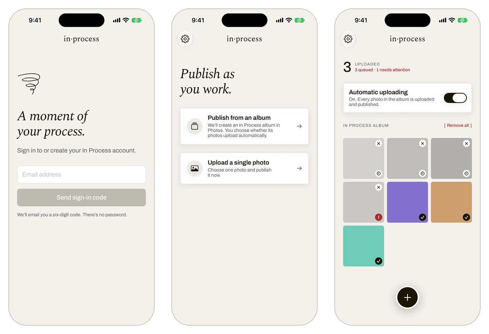
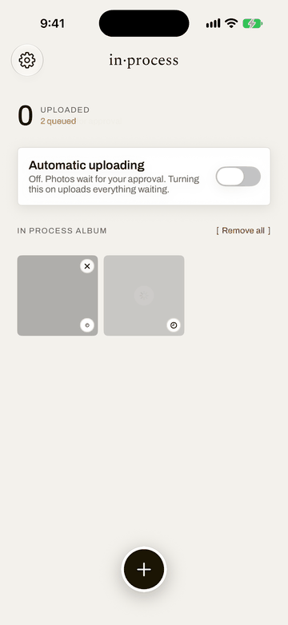

# In Process for iOS

A native iPhone app for publishing photos to [In Process](https://inprocess.world), a collective timeline for artists.

Put a photo in an album on your phone and it becomes a Moment on your In Process timeline. The app does the uploading, in the background where iOS allows it.

<p align="center">
  
</p>

## What it does

- **Sign in with your email.** In Process emails a six-digit code; there is no password.
- **Publish from an album.** The app creates an album called "In Process" in Apple Photos. Photos you put in it are published as Moments.
- **Choose how much is automatic.** With automatic uploading on, every photo added to the album is published with no further step. With it off, photos wait in the app until you approve them, one at a time or all at once.
- **Publish a single photo.** Pick one photo, add an optional title and description, and publish it straight away.
- **See what is live.** The home screen shows every photo in the album. Published photos are in colour; everything still waiting is grey.

<p align="center">
  
</p>

Photos are uploaded as they are: the current edited version from Photos, with no resizing, conversion or metadata stripping. Embedded metadata such as location is included, so check a photo before you publish it. Videos are not uploaded.

## How it relates to In Process

[inprocess.world](https://inprocess.world) is the web app where Moments are created, viewed and collected. This app is another way to create them. It signs in to the same account, publishes to your default collection through the public In Process API ([docs.inprocess.world](https://docs.inprocess.world)), and links each published photo back to its Moment on the site.

Moments are published with the same defaults the web app uses: open edition, collect price of 1 USDC on Base. In Process covers the cost of uploading.

## How uploading works

- **In the background.** The app includes a Photos background upload extension (new in iOS 27). Photos wakes it to upload new album photos while the app is closed. iOS decides when that happens, and it can be slow to start.
- **While the app is open.** Whenever the app is in front, it uploads anything queued itself, one photo at a time, so you are not left waiting on the system.
- **Without duplicates.** Each upload is recorded on the device before the Moment is created. If the outcome of a create is uncertain, the app checks for the Moment instead of creating it again.

## Requirements

- Xcode with the iOS 27 SDK
- An iPhone or Simulator running iOS 27
- An In Process account (the app can create one at sign-in)

Background uploading needs a physical iPhone. In the Simulator, photos upload only while the app is open.

## Building

The Xcode project has no third-party dependencies.

```sh
xcodebuild -project InProcess.xcodeproj -scheme InProcess -configuration Debug \
  -destination 'generic/platform=iOS Simulator' -derivedDataPath .build/DerivedData build
```

To run on a device, create `Config/Local.xcconfig` with your own Apple developer team. Git ignores this file:

```
DEVELOPMENT_TEAM = ABCDE12345
```

You will also need your own bundle identifier, App Group and Keychain access group for the app and its upload extension. Those are set in `scripts/generate-project.py`, which generates `InProcess.xcodeproj`; run it again after changing them or after adding or removing source files:

```sh
python3 scripts/generate-project.py
```

## Testing

The tests run offline. They use generated photos and fake services, and never sign in, send email or publish anything.

```sh
xcodebuild -project InProcess.xcodeproj -scheme InProcess \
  -destination 'platform=iOS Simulator,name=iPhone 17,OS=latest' \
  -derivedDataPath .build/DerivedData -parallel-testing-enabled NO \
  -only-testing:InProcessTests \
  -only-testing:InProcessUITests/PublishUITests \
  -only-testing:InProcessUITests/AutomaticUploadUITests \
  -only-testing:InProcessUITests/SignInUITests test
```

## Project layout

| Path | What is in it |
|---|---|
| `InProcess/App` | App entry point and the main app model (sign-in, single-photo publishing) |
| `InProcess/Views` | SwiftUI screens and the visual theme |
| `InProcess/Automatic` | Album scanning, the upload queue, and background and foreground uploading |
| `InProcess/Services` | In Process API client, credentials, Keychain storage, photo handling |
| `InProcess/Testing` | Fake services used by the UI tests |
| `InProcessUploadExtension` | The Photos background upload extension |
| `InProcessTests`, `InProcessUITests` | Unit and UI tests |
| `docs` | Design notes, investigation write-ups and test results |
| `AGENTS.md` | Detailed notes on structure, rules and validation for contributors |

## Known limitations

- iOS 27 and iPhone only, portrait only.
- Background uploads start when Photos decides to run them. Opening the app uploads anything waiting.
- After reinstalling the app, or on a second phone, the app cannot tell which album photos were already published. It connects an existing album with automatic uploading off so nothing is published twice by accident, but approving an already-published photo publishes it again.
- Album photos are published without a title or description.
- Successful publication does not by itself mean the media is stored permanently.

## Notes on configuration

`InProcess/Resources/ServiceConfig.plist` contains the storage endpoint and its public client key. This is the anonymous, publishable key that a client app is meant to carry; it is not a secret.

## Fonts

The app bundles [Archivo](https://github.com/Omnibus-Type/Archivo) and [Spectral](https://github.com/productiontype/Spectral), both under the SIL Open Font License. The licence texts are in `InProcess/Resources/Fonts`.

## Licence

The code is released under the [MIT License](LICENSE). The bundled fonts keep their own licence, as noted above.
