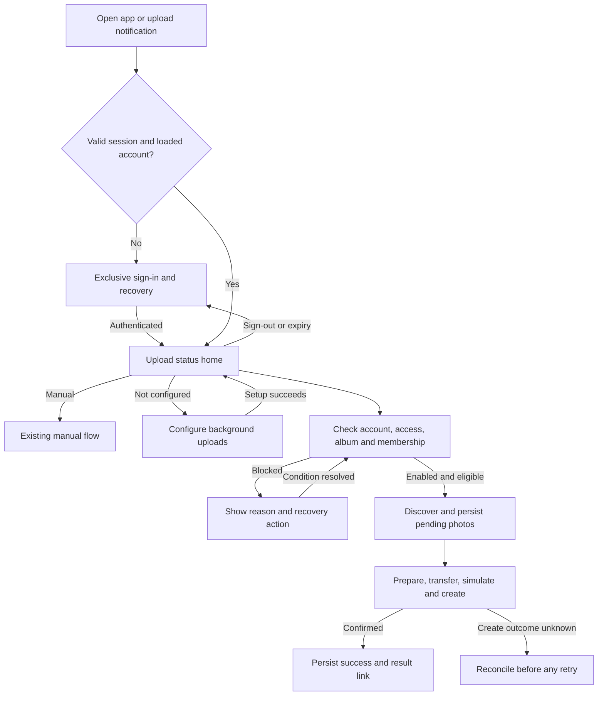

# Automatic uploads from a Photos album

Date: November 8, 2026

Status: iOS implementation and offline validation are recorded below. Normal album setup is available for the device-verified storage endpoint with a narrowly pinned compatibility exception. The user confirmed one full automatic photo publication with Resource Upload Test Mode ON. With Test Mode subsequently OFF, a different photo remained Pending overnight; normal-mode scheduling is unresolved. The existing [manual MVP plan](ios-mvp-plan.md) and its milestone history remain intact. Follow [root AGENTS.md](../AGENTS.md) when implementing and testing.

## Latest status — November 9, 2026

### Standalone PhotoKit reproduction

The user authorized a smaller isolated reproduction and investigation of Apple's intended membership-wake behavior, while explicitly declining Apple correspondence. [AlbumWakeRepro](../diagnostics/AlbumWakeRepro/README.md) is a separate generated two-target Xcode project, compiling only 230 lines across three Swift files. Its 19-line extension records actual process entry, snapshots PhotoKit counts and returns `completed` (or `failure` on error). It has no production coordinator/API/storage/Keychain, resource reads, jobs, observers, timers or permanent `processing` result. A separate App Group holds only the diagnostic configuration and per-process event files.

The signed host and extension were verified as `com.xdjs.AlbumWakeRepro` / `.WakeExtension`, with only `group.com.xdjs.AlbumWakeRepro` and no Keychain access group. The production app was not replaced or reinstalled. Offline isolation checks, Simulator compilation, unsigned device compilation and signed Debug device compilation passed. The actual device UI was inspected. At 13:05:12 PST the standalone extension initialized, read an empty test album with zero inserted/updated/deleted assets, returned `completed`, and received termination. Photos' runner identified the standalone bundle; the OS then reported the extension suspended. Thus this zero-job configuration did obtain initial execution, despite declaring the non-routable `https://example.invalid` URL base.

The standalone membership experiment also produced **no observed post-add extension invocation**:

| Time (PST) | Standalone evidence |
| --- | --- |
| 13:05:29 | Host entered background, after the verified initial extension completion. |
| 13:06:25 | Added the existing 12:07 synthetic card to the newly created isolated album in Apple Photos. General library count remained 42,877. |
| 13:07:01–13:12:13 | One member/card visually verified, then Home and a bounded observation of just over five minutes. No host activity or extension entry appears in the retained files. No install, re-enable, new asset or resource edit was performed. |
| 13:12:36 | First host activation after the window, explicitly for export/readback. The initial extension invocation remains the only one in retained history. |
| 13:12:50 | Foreground history snapshot: album changed, one member, seven history records, **zero inserted/deleted assets** and one updated asset. No background-discovery claim is made for this readback. |
| 13:13:07–13:14:01 | Disabled the separate diagnostic extension; removed the card from its test album only. Final snapshot confirms extension disabled, zero members, zero inserted/deleted assets. The empty test album and original fixture are preserved. |

Mirroring was deliberately left open, but showed **Connection Paused** at readback; neither uninterrupted connectivity nor disconnected idle conditions are claimed. Test Mode was last visually verified OFF at 12:39 and was not changed for this run. The retained host lifecycle establishes the background interval independently of Mirroring. Photos' OS logs identify the initial standalone worker and its suspended state; lack of later logged entry is not a diagnosis of the scheduler's internal reason.

This is a reduced reproduction of the observation, not an album-only wake fix or complete product acceptance. Production coordinator/authentication/network/ledger code is absent from both compiled diagnostic targets, so that code is not necessary to reproduce the bounded missing-invocation result. Zero-job configuration, an inert URL base, normal scheduling conditions, finite observation time and mixed Mirroring state remain experimental limits. A later invocation remains possible. The smallest unresolved question is whether a completed extension is intended to become eligible from an existing asset's membership-only change, and which conditions distinguish that from merely deferring execution.

The diagnostic app remains installed but disabled, its test album empty, capture stopped and the phone returned Home. Production installation, signing identity, settings and data were not modified by this standalone run. No upload/download job, new photo/video, Moment, credential request, Apple feedback or other correspondence occurred. Raw evidence is ignored in `docs/verification/album-wake-minimal-2026-11-09/`. The work remains uncommitted on `codex/discovery-lifecycle`; no merge or push occurred.

The [local runbook](../diagnostics/AlbumWakeRepro/README.md#what-apple-specifies) records the reviewed current Apple guide, inline sample, observer documentation and iOS 27.2 SDK semantics. They describe library monitoring and opportunistic scheduling, but do not define a membership-only launch guarantee, expose an album subscription option, or specify that a persistent observer can launch a suspended process. The absence of that guarantee is not evidence that membership-only wake is prohibited or impossible. A saved token can recover history once execution occurs; it cannot itself request execution. No fallback transport or product-scope change was added.

### Membership-only device result and final state

**The requested album-only wake is not fixed or accepted.** After the Mac/iPhone restarts, Mirroring recovered and the saved diagnostic isolation was verified. Resource Upload Test Mode was visually OFF. One non-publishing run woke, but persistent history contained one newly inserted asset and the user confirmed importing a video on a synced iPad. That run is confounded; it is not evidence that album membership triggered the extension.

A second bounded run used the same existing, byte-verified synthetic card, with no new photo/video or resource edit requested. Production remained paused behind the diagnostic marker. The retained log establishes these boundaries (PST, November 9):

| Time | Evidence |
| --- | --- |
| 12:46:12.634–12:46:12.647 | Initial extension snapshot: six album members, card absent, zero inserted/updated/deleted assets; returned `completed`, then terminated. |
| 12:46:43.433 | Host entered background. |
| 12:47:49 | Existing card added to the watched album; seven members and the card were visually verified. |
| 12:48:48–12:56:56 | Bounded observation. User reopened Mirroring at approximately 12:50; this is a **mixed Mirroring state**, not a continuously disconnected idle-phone test. No host foreground or extension invocation appears in the retained log. |
| 12:57:35.205 | First subsequent host startup, explicitly requested after the window to export retained history. The existing build confirmed seven members/card present, without re-enabling the extension. |
| 12:57:50 onward | Readback build installed in place **after** the observation; this installation is outside the acceptance window. |
| 12:57:56.523 | Explicit host-only persistent-history readback: watched collection changed, card present, seven members, nine history records, **zero inserted assets**, three updated assets and zero deleted assets. This is foreground readback, not independent discovery. |
| 12:58:35–12:58:48 | Removed the card from the album only, preserving its library asset; verified six members. Diagnostic restoration verified the card absent, removed its marker and restored saved `paused=false`, extension enabled. |
| 12:58:59–12:59:03 | Normal launch restored the existing valid session. Foreground scans found five eligible stills with zero pending/uploading work and no new enqueue or publication. |

The retained file contains the baseline, host-background boundary, and explicit post-window launch with no intervening events. Live USB capture omitted some baseline records, so it is corroborating evidence rather than the sole source of the negative result. The readback proves the watched collection's change was available in Photos history without a new-asset insertion. Updated-asset counts do not identify a resource edit or explain scheduling. No independent album-only wake was observed within the bounded window; neither this absence nor mixed Mirroring state establishes an OS defect or proves that a later wake could never occur.

The concrete unresolved boundary is **execution opportunity after existing-asset album membership changes**, before any app discovery code can run. Persistent-history tokens and both Photos observer registrations were present in the diagnostic and did not produce an observed invocation in this window. The lifecycle correction below remains independently tested, but it did not establish the requested device acceptance. No commit, merge, push, backend change, additional key issuance, OTP request or synthetic publication was performed during this reproduction. Capture is stopped; the app was returned Home with its original upload settings and credentials preserved.

An opportunistic BackgroundTasks scan alone would not complete this app's publication path: `PhotoKitTransfer.submit` explicitly requires the upload extension. A different transport/lifecycle design would be needed to make such a fallback independently useful, and BackgroundTasks still provides no launch deadline. No fallback, repeated re-enable loop, artificial media mutation or permanent `processing` result was added. The evidence is retained locally; no Apple feedback or external correspondence has been drafted or sent.

Verification after resuming: **90 core tests plus the diagnostics-export UI test passed (91/91)**, including DevelopmentLog file/flow tests. The final signed Debug device build passed and its diagnostic UI/readback/restoration were inspected on the phone. Earlier selected Publish/SignIn UI and unsigned Release device-build results remain separate, as recorded below. Local evidence, retained exports, screenshots, boundaries and test results are ignored under `docs/verification/album-wake-repro-2026-11-09/`; none are added to Git.

### Focused discovery investigation

The extension could previously return `completed` when its transfer adapter found an already-registered, still-pending PhotoKit job, or when a publication lease/network policy prevented a processing pass. It now distinguishes these cases from a confirmed empty queue: registered transfers remain `processing`; a pass that could not examine work returns `failure`. It neither creates a replacement job nor uses a polling timer. Two new regression tests failed against the original implementation and pass with the correction. All **87 core tests**, the signed Debug device build, and the unsigned Release device build pass. The previous 25 passing UI tests were not rerun for this coordinator-only change.

The installed extension's point identifier, URL-base declaration, iOS 27 async protocol and atomic enable/options calls match the SDK. The options expose network policy, not an album identifier or wake subscription. [Apple's background-upload guide](https://developer.apple.com/documentation/photokit/uploading-asset-resources-in-the-background) says a completed cycle enters library-change monitoring, with scheduling controlled by power, network and device activity. Its persistent-change tokens track discovery progress; the API does not pass a token to extension enablement or completion. Full connected-album reconciliation already finds an existing still newly added to the album in offline tests. No documented requirement was found that adding a token or a persistent-change observer would make a suspended extension launch, nor a specific prompt-wake guarantee for album-membership-only changes. Do not claim that changing lifecycle results fixes idle discovery.

The earlier app-owned key was explicitly revoked by an actual Sign out at 11:38 PST (HTTP 200 for that exact owned key). No independent request using the revoked secret was made. For the separately authorized discovery test, one OTP sign-in created one new app-owned key at 11:50, with authenticated identity/default-collection reads. Uploads stayed paused until 11:52:29. Test Mode was visually OFF; charging and Wi-Fi were user-confirmed and visually observed. The build was installed in place, preserving the queue and credentials.

At 11:52:29, Resume released the previously host-enqueued waterfall as a **positive control only**. The extension registered its resource job, acknowledged completion, and successfully created Moment 10 at 11:52:46. The host had entered background at 11:52:35; Mirroring was disconnected and the phone was locked. Public cache-busted readback confirmed Moment 10. The extension returned `completed` at 11:52:47 after finding no remaining work. This verifies key-authenticated background publication and locked-device shared credential access in this run, not independent discovery.

At 11:53:56, one different existing still was added using Apple Photos. Visual inspection confirmed its thumbnail in the connected In Process album and six items (five stills and one video). The host was never foregrounded after its 11:52:35 boundary. Photos was returned Home, Mirroring disconnected, and the phone's locked state verified by 11:54:57. Through **12:04:14** (10 minutes 17 seconds after insertion), a live USB log stream recorded no post-add host/extension activity, invocation or enqueue. Cache-busted public readback still showed Moment 10. The phone remained locked at the end of that window. This comparison did **not** establish independent discovery, and ten minutes is an observation bound, not an Apple scheduling guarantee.

Scoped Photos daemon logs show its resource-upload extension runner skipping work for the current criteria at 11:55:20, 11:55:53, 11:58:15 and 12:01:00. The library bundle is private in these messages; they are not an app-specific eligibility rejection or a diagnosis of the missing wake. Other system tasks reported device-activity/thermal/concurrency constraints, which likewise cannot be assigned as this extension's cause. The live stream avoids the previous confound of reopening the host to export logs. A separately authorized follow-up compares a newly created synthetic library asset **outside** the watched album; only the existing authorized waterfall is eligible for publication. That comparison is intended to narrow trigger hypotheses, not establish causality from timing alone.

**The new-asset comparison reached independent discovery and publication.** At 12:07:41, Safari saved one generated PNG labeled “WAKE-ONLY TEST / NOT FOR PUBLICATION” to the general Photos library. Visual inspection confirmed the card and the library count increasing from 42,875 to 42,876; the connected album remained at six items without the card. The phone was Home/locked and Mirroring disconnected again by 12:08:26. No host launch, reinstall, re-enable or Test Mode change occurred between the album insertion and publication.

| Time (PST) | Observed evidence |
| --- | --- |
| 12:07:41 | Photos signaled resource-upload runner work immediately after saving the synthetic library asset. |
| 12:07:55–12:08:01 | A configuration changed to `processing`; Photos found work and submitted its runner task. |
| 12:08:01–12:09:04 | The scheduler reported zero available slots in the Photos concurrency group for that specific runner task. This explains an observed scheduling constraint after submission, not why the earlier album-only change produced no recorded invocation. |
| 12:09:53 | That task started. The Photos worker explicitly identified `com.xdjs.InProcess`, associating the previously private configuration with this app. |
| 12:09:54 | `role=uploadExtension` emitted the new waterfall's first enqueue. The scan found five eligible stills in the connected album, and exactly one new operation. |
| 12:09:55–12:10:34 | The extension registered the resource job; Photos transferred 527,427 bytes and reported success; the extension acknowledged it. |
| 12:10:40 | The extension's Moment create returned HTTP 200. |
| 12:10:46–12:10:48 | The extension reported zero pending/uploading work; Photos logged event-monitoring-only state for the same configuration. |
| 12:10:54 | Cache-busted public readback confirmed Moment 11. Its media URL matched the extension-created operation; the public object returned HTTP 200, `image/jpeg`, 527,427 bytes. The generated card was not uploaded. |

This verifies an extension-originated scan, enqueue, resource upload and publication of an existing album still with the host continuously backgrounded, under normal Test Mode OFF conditions. It **does not yet pass the album-only wake acceptance gate**: the successful invocation followed a separate new-library-asset event. The timing and explicit Photos work signal strengthen that trigger hypothesis, but one comparison does not prove exclusive causality or a platform defect. No scheduling workaround was added. Hold commits/merges until device acceptance is established.

The next discriminating investigation is an isolated, non-publishing reproduction of an idle extension's wake behavior for existing-asset album membership versus changes to the existing synthetic card's resource, with Photos scheduler capture starting before both events and the configuration associated with the app. Apple feedback should include the observed configuration transition and missing album-only invocation, without claiming that generic worker messages prove an app-specific rejection. At the end of the publication comparison, the phone remained signed in with uploads enabled, its two authorized stills published, and the synthetic probe outside the album.

The Debug-only `AlbumWakeProbe` routes the host and extension away from production API/credential construction, retains collection/member fetches, registers both ordinary and persistent Photos change observers, and records bounded persistent-history counts. Arming requires an empty queue and pauses production under its publication lease; restoring requires the synthetic card to be outside the connected album. It creates no asset, upload job or publication. It returns `completed` after an observation pass instead of keeping the extension artificially active. Three isolated storage/fail-closed tests bring the core suite to **90 passing tests**. The six selected Publish, SignIn and diagnostics-export UI tests and signed Debug/unsigned Release device builds also pass. The first device startup attempts did not establish an armed probe or idle baseline; the later successful baseline is recorded below.

After the requested unlock/lock step, Mirroring again timed out. A wired developer screenshot succeeded and showed the lock screen; the subsequent explicit diagnostic launch was denied by SpringBoard with `FBSOpenApplicationErrorDomain` code 7 (`Locked`). Additional source-sanitized startup checkpoints record only candidate counts, fixture-match success and setup outcome. Their signed Debug build passed, was installed in place, and all ten DevelopmentLog file/flow plus diagnostics-export checks passed. At that checkpoint the updated diagnostic had not launched successfully. This was a device-access blocker, not evidence about Photos wake behavior or missing extension registration; the existing synthetic card had not been moved into the album.

The user then left the phone unlocked. The diagnostic launched at 12:27 PST and identified a filename-dependent setup failure: one dimension/date-bounded candidate existed, but Safari's saved resource did not retain the downloaded filename. The probe now requires exactly one candidate and verifies the original fixture's full byte hash before arming. Its signed build passed and was installed in place. At **12:27:41**, the hash matched, production pause was persisted, and explicit diagnostic enablement succeeded. At **12:27:42**, the actual extension observed six connected-album items with the synthetic card absent and returned `completed`; Photos identified `com.xdjs.InProcess` and transitioned its configuration to `eventmonitor`. Both ordinary and persistent change observers delivered baseline callbacks. Photos was launched at 12:27:55 to background the host. This establishes a diagnostic idle baseline, not a successful membership trigger. At that pre-reboot checkpoint, no membership change had yet occurred in the reproduction.

The experiment was then held at the user's direction for Mirroring troubleshooting, with the probe armed and production paused. Mac Wi-Fi/Bluetooth were on and the phone was confirmed locked. Scoped Mac logs show Mirroring timing out during `sessionInitializing`, after a satisfied/viable AWDL path and a QUIC transport connection. This narrows the observed connection stage but does not identify the root cause. No reset, reboot, pairing or network change was performed. Capture ended at the hold boundary; the post-reboot run above used fresh capture and re-established the baseline. Artifacts remain ignored under `docs/verification/album-wake-repro-2026-11-09/`.

A supported fallback could request a bounded `BGAppRefreshTask` or `BGProcessingTask` to reconcile the connected album using the same durable queue/lease, with expiration cancellation and accurate last-check status. This is a possible additional opportunity, not an album-change subscription or a guaranteed interval: [Apple's background-execution guidance](https://developer.apple.com/forums/thread/685525) explains that refresh may receive no runtime, and [`earliestBeginDate`](https://developer.apple.com/documentation/backgroundtasks/bgtaskrequest/earliestbegindate) is only a lower bound. No fallback has been implemented or represented as acceptance of the requested album-only workflow. Persistent observers likewise provide change delivery while code can execute; [Apple's explanation of their purpose](https://developer.apple.com/forums/thread/833067) does not document a suspended-process launch guarantee. Tokens let a later invocation recover history, not choose its launch time.

Before this run, supported device crash-log enumeration found no matching app/extension crash reports. A Jetsam report inside the earlier failed observation window listed both processes suspended, without identifying either as a killed victim. This does not prove that all historical launch failures or OS scheduling restrictions are absent. Current normal-mode invocation and transfer success rule out a generally broken extension registration or inaccessible shared credential in this run. Raw artifacts remain ignored under `docs/verification/discovery-contract-2026-11-09/`.

### Earlier credential and discovery checkpoints

Email OTP now bootstraps a persistent installation-specific artist key for host and extension. See [the credential lifecycle](#device-artist-key-authentication) below for migration, crash recovery, rejection, and sign-out revocation. This removes the app's hourly JWT lifetime from routine artist-key use; it does not fix or prove OS discovery scheduling.

Offline validation: **85 core tests and 25 UI tests pass (110 distinct tests)**. The complete regression run passed 82 core plus all 25 UI tests; the final run passed all 85 core plus four sign-in UI tests after adding transport-persistence, unreadable-revocation-state and pre-issuance outage recovery coverage. There are no unresolved test failures. Rendered sign-in/home/pending-revocation UI was inspected. The first recovery UI run exposed a helper appending to the restored email; correcting the helper made the recovery test pass. Final signed Debug and unsigned Release device builds passed. Disposable UUID-scoped Keychain tests exercise real SecItem operations and shared-vault readback without touching production items.

The authorized physical auth-only check at 11:31 PST created **one** app-owned key. Sanitized network events show successful key creation, key-authenticated identity/default-collection reads, authenticated key-ID resolution, and simulation against existing published metadata. There were **zero** media/metadata uploads, Moment create requests, or key revoke requests in that check. A signed build was installed in place and a normal 11:32 relaunch restored authenticated state with fresh identity/default-collection HTTP 200 responses and no OTP or key creation. Automatic uploads were **paused** at that checkpoint, preserving the pending waterfall; cache-busted timeline readback at 11:32 still showed Moment 9 and no new publication. Later revocation and publication results are recorded above. Raw diagnostics and screenshots remain ignored under `docs/verification/artist-credentials-2026-11-09/`.

The extension result mapping now returns `failure` when an invocation makes no progress and a persisted blocker remains, including expired credentials, unavailable Photos access, a missing album, or an account mismatch. Previously these blockers could return `completed` despite not establishing that discovery was up to date. The real extension and offline tests share this mapping. Progress still returns `processing`; an unblocked idle invocation still returns `completed`. This corrects lifecycle reporting; it does not renew credentials or establish when iOS will invoke the extension.

Validation: all 53 core tests passed on Simulator, and the unsigned Release device build passed. Regression tests cover blocker outcomes/recovery with pending records preserved, plus discovery of an existing photo newly added to an initially empty album, transfer acknowledgment, and exactly one publication across reconstructed workers without a host scan. These use injected adapters and explicitly invoke the worker; they do not prove OS scheduling. The signed Debug build passed, host/extension signing and shared groups were checked, and the fixed build was installed in place without clearing the session or queue.

**Independent normal-mode background discovery remains unresolved.** A controlled physical test with Resource Upload Test Mode visually OFF, valid credentials, the existing album enabled, and zero pending/uploading items produced this sequence on November 9, 2026 (Pacific Standard Time):

| Time | Observed evidence |
| --- | --- |
| 10:38:30 | Host background command; the app logged background at 10:38:31. |
| 10:41:57–10:41:59 | Extension invoked, scanned the existing three stills and one video, found an empty queue, and returned `completed`. |
| 10:42:16 | One authorized waterfall still added through Apple Photos. Subsequent visual inspection confirmed the intended thumbnail in the correct album and the count changing from 4 to 5; no second add attempt was made. |
| Through 10:57:24 | No post-add extension invocation or enqueue appeared in retained logs during the 15-minute observation window. Public readback showed no new publication. The host remained backgrounded. |
| 10:57:30 | Host reopened for diagnostic export; its normal foreground scan performed the first enqueue. This cannot count as independent extension discovery. |

The fresh export retained all 1,459 baseline events within 1,560 total events; the host reported zero file-write failures, and the session was still valid. The host was returned to the background after export. No repeat photo was added. Absence of a recorded invocation does not identify the OS scheduling cause, and any later publication following this host enqueue cannot establish independent discovery for this run. Raw logs, screenshots, readbacks and detailed boundaries remain ignored under `docs/verification/independent-discovery-2026-11-09/`; test/build evidence remains under `docs/verification/background-discovery-investigation-2026-11-09/`. See [the diagnostics guide](development-diagnostics.md) for export and retention limits. Earlier probe observations of no configured album and Test Mode ON below are historical.

## Implementation and verification record

The code now includes an exclusive authentication gate, Upload status as every authenticated account’s home, explicit album consent and selection, status/history, sign-in recovery, optional notifications, cellular-on defaults, pause/resume, manual entry, and published links. Reconnecting an album is explicit; setup does not silently recreate a deleted one. Original manual Publish remains a single tap. A durable sign-out flag prevents background publication even if credential deletion fails.

`UploadStore` owns a versioned account-scoped ledger in an App Group. A short file lock makes queue transactions atomic across processes; a separate nonblocking OS file lock spans publication awaits and is released on process death. PhotoKit operation identity is encoded in a stable destination URL before job creation, so registration can be recovered without relying on a response body. Transfer results and job receipts are durable before acknowledgment. Failed responses can be reconciled against a locally available job resource and the stored object bytes. Create is preceded by a durable submitting checkpoint; an interrupted or invalid response remains uncertain and is read back instead of recreated.

Album scans are bounded to the connected collection and use full reconciliation rather than depending on persistent change-token validity. Pending removals cancel; missing access/album retains pending state and records one incident notice. Removed registered jobs are canceled where possible, and a canceled operation ignores a late success. Already completed publication is retained. Retries reuse operation identity, back off, and stop after three failures until an explicit retry. Each extension invocation limits new work and performs at most one publication. A testable coordinator owns these policies; PhotoKit is an adapter, not the test harness.

Manual and automatic paths share current-rendition selection and format metadata. Unchanged JPEG/PNG/HEIC bytes remain identical; orientation and embedded metadata stay intact. A narrowly callable conversion helper requires a verified compatibility reason, preserves dimensions and copies metadata, and records detected metadata alterations; no service requirement currently invokes it. Other alterations are shown in the manual review/history and attempt one notification when permitted. This does not add a publication confirmation. Original-format server display derivatives remain outside claims of original-byte identity.

Host and extension now share a verified `AfterFirstUnlockThisDeviceOnly` Keychain credential envelope. Legacy manual/shared entries are migration inputs only; an envelope tombstone prevents their resurrection after sign-out. Shared files use complete-until-first-authentication protection and are excluded from backup. The signed host/extension profiles and entitlements were verified for the connected phone; shared App Group access subsequently passed, including the locked-after-first-unlock diagnostic. Shared authenticated Keychain access still needs real publication validation. Existing draft JSON decodes without the new optional identity/format fields; successful current manual drafts can be recorded, but unmappable history is not fabricated.

The album-setup regression snapshot contained 36 core tests and 20 real-UI tests with injected services (56 distinct tests). Album-setup validation initially passed 55/56, with one test incorrectly looking up the Settings link as a button. After correcting that accessibility query and retaining the consent disclosures on the direct album screen, all 36 core tests and six affected UI tests passed (42/42); all 56 distinct tests now have passing results. Coverage includes preauthorized setup without a permission action, first full-access grant, empty album lists, limited/denied/restricted recovery, return from Settings, request progress and duplicate suppression, retry after album-read failure, and no album creation/enablement during preparation. Existing auth gating, notification entry, configuration/queue preservation, endpoint constraints and single-tap Publish remain covered. Rendered before/after screenshots and result bundles are in ignored `docs/verification/album-setup-2026-11-08/`; earlier auth/endpoint evidence remains in `auth-navigation-2026-11-08/`.

**Physical one-image diagnostic passed; broader acceptance remains open:** signed host/extension provisioning and actual execution were verified on iOS 27.2. One generated PNG completed through PhotoKit against the existing endpoint despite raw OPTIONS 200/no Upload-Limit. Public readback matched the Photos resource SHA-256 and 2,952-byte size. Test Mode was off; Mirroring stayed connected during transfer. No Moment or metadata was created, and no backend change was made. Production setup now recognizes this exact device-verified service with constrained request/response checks; other ambiguous endpoints remain blocked. See [the phone diagnostic result](phone-diagnostic-checklist.md) and [server evidence](photokit-server-requirements.md).

Actual extension activation and shared App Group access passed in the diagnostic. Two later authorized operations reused the generated PNG and passed with the host backgrounded/Mirroring connected and with Mirroring disconnected/device passcode required, respectively; both used Test Mode ON and Xcode development runs. Source/readback SHA-256 matched, and lifecycle/time gates ensured registration and completion occurred after the relevant transition. Upload status includes a compact Configuration card: current connected album title (resolved by its saved identifier, including renames/unavailability), actual Photos extension enablement alongside pause policy, network policy, current Photos and notification authorization, shared upload-session validity, destination name and publication defaults. The card is reachable only after authentication, including before album setup. Readback does not prompt for permissions, scan album members, register jobs, or contact publication services. It refreshes on screen entry, app activation, Photos changes and policy actions. Debug-only disclosure explains that system Resource Upload Test Mode is managed by Developer settings and cannot be read in-app. At that diagnostic milestone, the user requested that system switch ON; the later normal-mode experiment used OFF. Xcode development runs and both mirrored-background and disconnected/locked synthetic transfers subsequently passed; see the phone checklist for timestamps, verified bytes and remaining normal-mode limits.

The remaining physical-device gate includes independent idle album-change discovery under normal scheduling, iCloud/current-edit resource fidelity, job capacity and cancellation behavior, notifications/routing, cellular transitions, and actual 501/resumable behavior against a controlled endpoint. The November 9 positive control above exercised shared artist-key access, media/metadata/create/publication readback, ancillary API networking, and continuation under lock; it does not establish reliable unattended discovery or all network/power conditions. Large/HDR/10-bit HEIF variants and real bucket limits remain unverified. Do not label mock event execution as PhotoKit execution or promise force-quit scheduling.

## Secure-storage setup correction

The installed host had the correct signed shared-Keychain entitlement but no `SharedKeychainGroup` in its generated Info.plist. The extension had the expanded key. The host therefore queried `missing-shared-keychain-group`, which was not entitled. The host now has an explicit Info.plist source with the same AppIdentifierPrefix-based group as the extension, wired through the project generator. The store rejects missing/unexpanded configuration before calling Security, reports only sanitized operation/OSStatus failures, retains the existing manual-session query, and uses update/add with a duplicate-insert race retry without deleting credentials. Shared items retain AfterFirstUnlockThisDeviceOnly; manual items retain WhenUnlockedThisDeviceOnly.

Setup now validates ownership, endpoint and secure credential saving **before creating an album**, then persists configuration and enables uploads only on the explicit user action. A failed secure save leaves the prior credential, queue, selected album and extension state intact. Earlier failed attempts could already have created an In Process album because the old sequence created it first; existing albums remain visible for explicit selection and are never automatically deleted or chosen.

Previous coordinator/UI tests used in-memory session stores and did not exercise SecItem or built bundle metadata. New `KeychainIntegrationTests` use actual Keychain calls with disposable UUID-scoped services and verify both built plists, add/read/update/delete, protection, and fail-closed missing configuration. Removing the key from the built Simulator host made `testBuiltHostAndExtensionResolveSameSharedGroup` fail at its required unwrap; restoring it passed. Setup failure/retry tests assert no album creation or extension enablement on secure-save failure, retained queue/session/selection, and use of an existing album without creating another. Simulator results do not establish physical-device profile behavior or extension-process execution.

A Debug-only `--keychain-probe` launch is reserved for explicitly authorized diagnostics. It constructs no API or coordinator, never enables PhotoKit, uses disposable synthetic credentials only, removes its exact probe items, and exports booleans/status codes plus read-only album/configuration identifiers to Documents. Production credentials are never exported. Evidence is under ignored `docs/verification/keychain-setup-2026-11-08/`. The corrected signed build was installed in place. On the physical phone the original placeholder query returned **-34018 (errSecMissingEntitlement)**, while the corrected group passed synthetic add/read/update, protection readback and exact-item deletion. Full Photos access was present; the read-only inventory returned zero matching In Process albums and no automatic configuration. The app was then relaunched normally with no diagnostic arguments. No production credential was modified by the probe, no album was created/selected, and no upload or Moment was triggered. Actual extension-process credential access remains a separate integration boundary. The focused regression runs passed 44/44 and 7/7 (45 distinct tests this change), and the intentionally broken built-plist check failed as expected before restoration. The total offline suite now contains 42 core and 21 UI tests; the unaffected UI tests retain their prior passing evidence.

## Goal and scope

Require **iOS 27 or later across the entire iPhone-only In Process app**, including the working manual single-photo flow. There is no older-iOS manual fallback. Add an opt-in experience resembling Google Photos: configure once, then add photos to an **In Process Photos album in Apple Photos, outside this app**. Eligible album members that have not been published through this app are published automatically with the agreed defaults. There is no per-photo review or confirmation in this mode.

The **Photos album** is the local source of photos. The website's **Process/default collection** is the publication destination; these are different concepts. Full Photos permission does not authorize uploading the whole library. Discovery must be restricted to the connected album.

The desired experience is eventual automatic publication with infrequent app visits. Two accepted constraints prevent promising a completely unattended service: iOS controls background opportunities, and the current login token requires renewed sign-in after expiry. This iteration keeps those constraints visible rather than adopting a new authentication system.

## Agreed product decisions

| Area | Decision |
| --- | --- |
| Device scope | iPhone only, portrait; preserve bundle identifier `com.xdjs.InProcess`. |
| Minimum OS — decided | **iOS 27 app-wide**, for manual and automatic uploads alike. No older-iOS manual fallback or older extension compatibility path. |
| Manual publishing | Keep the system picker, review screen, and immediate single Publish tap available. Automatic setup is optional. |
| Source | An Apple Photos album named **In Process**, created or connected during setup. Persist its local identifier, not only its display name. |
| Automatic consent | Setup clearly explains that adding photos to the connected album authorizes automatic public publication, without another review step. |
| Destination | Use the existing authenticated Process/default collection behavior on Base; never substitute a hardcoded account or collection. |
| Automatic publication metadata | Blank title and description; collect price **1 USDC** (`1000000` base units); open edition; no additional splits or user-defined schedule. No metadata customization in this iteration. |
| Media policy — decided | Both paths upload the current visible edited Photos rendition. Preserve compatible format, rendition dimensions and embedded metadata where feasible. Necessary compatibility format conversion is automatic without notification; other necessary alterations still require notification. |
| Costs | In Process handles upload costs. No payment or wallet-funding flow. The collect price is separate from upload costs. |
| Connectivity | Cellular uploads are **on by default**. A setting can turn them off for Wi-Fi-only operation; show **Waiting for Wi-Fi** when applicable. |
| Notifications | Request permission contextually during setup. Denial does not prevent automatic uploads; all problems remain visible in status. |
| Authenticated home | Upload status/history before and after setup, with manual upload and configuration access; configured accounts also have pause/resume. This is not a review queue or a full native social timeline. |
| Deduplication scope | Uploads made through this app, manual and automatic, for this installation and authenticated account. No cross-website or cross-device matching promise. |
| Album removal | If a photo is removed before upload starts, cancel its pending upload. Removing an already-published photo does not unpublish it. In-flight removal remains an open boundary below. |

Current storage is public Supabase HTTPS media/metadata. Automatic uploading must not imply an upgrade to verified Arweave permanence; that limitation remains as described in the existing MVP plan.

## Shared media policy: current Photos edits and compatible formats

This decision applies to **both manual and automatic uploads**. If a photo has been modified in Apple Photos, upload its **current visible edited rendition**, faithfully rendering those edits, rather than the untouched camera original. Original-versus-edited is decided; how to export that rendition correctly remains a technical validation task. The implemented resource selector uses the still photo/full-size edited photo and excludes paired video. Its behavior with real edited Live Photos remains a device validation item.

Preserve a compatible resource's format, the current rendition's dimensions, and embedded metadata as far as feasible. Preserve bytes when the selected current resource can be transferred unchanged. Rendering edits or converting a format changes bytes and may change metadata; do not claim byte-for-byte identity with the camera original or unconditional metadata identity in those cases. Dimensions resulting from the user's crop/edit are part of the intended rendition, not an app-imposed downsample. Do not routinely resize, recompress, convert everything to JPEG, or strip EXIF/GPS. Blank publication title/description are separate from embedded image metadata and do not authorize stripping it.

**Explicit notification exception:** a routine format conversion that is necessary for verified destination/rendering compatibility is authorized automatically **without notification or per-photo approval**. If HEIC works, retain HEIC. If verified behavior requires conversion, choose a suitable supported format such as JPEG or PNG based on fidelity and compatibility; the user has no preferred target. Missing documentation does not prove HEIC is unsupported and must not trigger blanket JPEG conversion. Rendering the user's existing Photos edits is the requested content, not a separate approval step.

**Other necessary alterations still require notification.** For example, an additional resize due to a verified size limit or loss of embedded metadata must be explained, even if it accompanies an otherwise notification-exempt format conversion. Record the actual alteration and reason in status/history and notify through the permitted surface. Notification timing/surface remains a UX detail, with an in-app explanation available when notification permission is denied. This does not introduce a per-photo review queue. Keep internal provenance of exports/conversions without forcing a notice for format-only compatibility conversion. If no justified compatible path exists, report an actionable item error instead of inventing a limit or silently changing other content.

**Implemented media policy:** `PhotoProcessor.swift` retains supported JPEG, PNG and HEIC/HEIF bytes and metadata instead of the historical routine JPEG/4096-pixel/5 MiB transformations. The 100 MiB manual preparation guard remains explicitly an app memory safeguard; it reports an error rather than shrinking an image. Metadata MIME and file/object extensions follow the selected data. With full Photos access, manual and automatic selection use the current full-size rendered photo when adjustment data exists, or the original still when unedited; a missing rendered resource is an actionable item error, never a fallback to the camera original. The picker uses current encoding when full-library access is unavailable. Historical MVP evidence below still describes the earlier behavior accurately.

**Verified documentation and remaining limits:** the documented 5 MB boundary for the Arweave upload route distinguishes free versus paid handling, not a proven upload-size cap. The image proxy's 4096 maximum applies to requested output width/height, not original uploads. The reviewed documentation establishes neither a general server upload maximum nor an EXIF-stripping requirement. Live evidence below establishes one ordinary HEIC path; it does not establish all HEIF variants, RAW, or Live Photo compatibility. Storage acceptance, correct MIME handling and rendering are separate checks; proxy conversion is not proof that the original must be changed. [Upload tiers](https://github.com/sweetmantech/in_process_docs/blob/main/arweave/upload-file-in-process.mdx), [image proxy](https://github.com/sweetmantech/in_process_docs/blob/main/api-reference/media/image.mdx), [OpenAPI schema](https://github.com/sweetmantech/in_process_docs/blob/main/api-reference/openapi.json).

The no-payment/funding decision still applies. A pricing threshold is not a reason to silently shrink an image, add a funding flow, or switch to a billing-sensitive upload route. Resolve a compatible platform-managed route during the integration work.

### Live media compatibility evidence — November 8, 2026

The authorized investigation used generated 320 × 240 geometric images, the app's existing public Supabase configuration and normal object-upload route, and read-only media/metadata endpoints. It did not send an OTP, simulate/create a Moment, invoke a payment/Arweave route, change backend configuration, or use personal photos. Local request records, hashes, decoded-image inspection and cleanup results are under ignored [media-compatibility evidence](verification/media-compatibility-2026-11-08/README.md).

| Check | Observed result | Scope |
| --- | --- | --- |
| Original object storage | HEIC (2,911 bytes), JPEG (6,202 bytes) and PNG (4,767 bytes) uploads returned HTTP 200. Public GET returned exactly the uploaded bytes and correct `image/heic`, `image/jpeg` and `image/png` MIME types. | Dimensions and a synthetic EXIF comment survived unchanged; no GPS or personal metadata was used. |
| Deployed image proxy | All three inputs produced valid 160 × 120 WebP output, HTTP 200. HEIC also produced valid full-size 320 × 240 JPEG and PNG output, HTTP 200; the PNG was visually inspected. | Display derivatives are converted/resized as requested and omit the synthetic EXIF comment. The original stored object remains unchanged. |
| Metadata readback | Uploaded synthetic metadata referencing HEIC returned unchanged through `/api/metadata`, HTTP 200, including `content.mime: image/heic`, image and content URIs. | This is metadata normalization/readback, not a newly created or indexed Moment. |
| Website display path | The deployed homepage emitted image-proxy URLs requesting WebP. Public web source routes external images through this loader and treats `image/*` metadata as image content. | Live proxy output plus source tracing supports HEIC display; a newly published HEIC Moment's complete UI flow was not exercised. |
| Limits and transfer protocol | Bucket configuration was not exposed to the normal public role. Exact-object OPTIONS returned HTTP 200 with generic method/CORS headers and no `Upload-Limit`. | Actual bucket/global upload limits and PhotoKit resumable-upload interoperability remain unknown. No stress/large-file probe was performed. |

Source snapshots reviewed: API main `0b4935411294f7f9aea6899529152524b307daf8`, web main `689792f45339c4acadcca4bcfad16aff66de45ab`. The API [detects HEIC/HEIF brands](https://github.com/sweetmantech/in_process_api/blob/0b4935411294f7f9aea6899529152524b307daf8/src/lib/media/isHeicBuffer.ts), [decodes them to JPEG with heic-convert](https://github.com/sweetmantech/in_process_api/blob/0b4935411294f7f9aea6899529152524b307daf8/src/lib/media/decodeHeicToJpegBuffer.ts), and [generates display output with Sharp](https://github.com/sweetmantech/in_process_api/blob/0b4935411294f7f9aea6899529152524b307daf8/src/lib/media/imageProxyHandler.ts). The [web image loader](https://github.com/sweetmantech/in_process_web/blob/689792f45339c4acadcca4bcfad16aff66de45ab/lib/media/imageLoader.ts) requests WebP from that proxy. These are public source snapshots consistent with the observations, not verified deployment commit IDs.

**Implementation decision:** retain compatible HEIC for uploads; blanket client-side JPEG conversion is not justified by the tested service path. The tested original can be stored unchanged while the service supplies browser-compatible display derivatives. Do not claim preservation of embedded metadata in those derivatives. Keep the agreed notice policy for additional alterations; its exact treatment of server-generated display derivatives remains to be specified separately from preservation of the published source object.

Remaining validation covers current edited Photos rendition export, realistic larger/HDR/10-bit and other HEIF variants, Live Photo still selection, actual size limits, the complete publication/indexing flow, and broader PhotoKit job/endpoint interoperability. A later separately authorized tiny-PNG PhotoKit operation passed, as recorded above; a generic OPTIONS result alone does not close the remaining gates. The manual app now retains supported formats.

Cleanup through the same normal public role returned HTTP 200 with an empty deletion result; fresh reads still returned all four synthetic objects. Their exact paths are recorded in the ignored evidence for later authorized cleanup. No privileged credentials or policy changes were attempted; service-managed proxy derivatives may also remain cached.

## Entry, setup, and home

### Initial entry

Unauthenticated users see only email-code sign-in or account-loading recovery. No Home, Upload status, manual upload, setup, or configuration navigation is available. After successful sign-in or valid-session restoration, **Upload status** is always home. Unconfigured accounts see **Not configured**, **Upload a single photo**, and **Configure background uploads**. Manual upload does not require full-library access.

Configured authenticated accounts retain status, history, configuration, pause/resume, cellular policy, and manual upload. Sign-out or expiry returns to exclusive sign-in, including expiry while the app is open or returning from background. Recovery explains that the album configuration, pending uploads, and draft are retained. Notification entry passes through the same authentication gate and reaches Upload status after successful sign-in; it cannot bypass email or code entry. No external URL scheme is currently registered.

### Setup

1. Explain the album workflow and automatic-publication consent before enabling it. Describe the fixed defaults, platform-managed costs, potential delays, and the need to reopen/sign in when required. Make the treatment of any existing album contents explicit before enabling.
2. Read Photos authorization when setup opens and when returning from Settings. Existing full access goes directly to the album selection/create stage, with no redundant request or Allow wording. Undetermined access shows an explicit permission action; a successful grant advances immediately. Limited/denied/restricted access shows recovery and manual upload; loading failures stay visible and retryable. Request full Photos **read/write** access only when not yet determined, for creating and reading the album. Limited or add-only access is insufficient for this workflow. Show recovery guidance and the manual-picker path when access is limited, denied, or restricted. Apple's documentation specifically excludes creating/fetching user albums under limited access. [PhotoKit privacy guidance](https://developer.apple.com/documentation/photokit/delivering-an-enhanced-privacy-experience-in-your-photos-app).
3. Present explicit existing-album and create-new choices; require a choice and separate publication consent before enabling. Loading the list or selecting the create option does not create an album or enable uploads. Create or explicitly connect the In Process album and persist its identifier with the owning app-account configuration. Naming collisions and the exact existing-album selection policy still need implementation design; do not silently choose an arbitrary album because its name matches. **Superseded November 20, 2026:** setup is now one confirm screen that creates an "In Process" album automatically, reuses an existing one only when empty, and stops with a warning when it already holds photos.
4. Save automatic uploads as enabled, with cellular allowed by default. Request local-notification permission in context, explaining that it reports conditions needing attention. Notification denial must not undo setup or disable uploads.
5. Open status/history, reconcile album membership, and start eligible work when the current conditions permit it. The user adds subsequent photos in Apple Photos; the app need not be open at that moment.

### Status/history home

Show an overall state: **Active**, **Paused**, **Waiting for Wi-Fi**, or **Needs attention**. Active means enabled and eligible to make progress when iOS allows execution; it does not mean a continuously running process. Show a last-check time so delayed discovery is understandable.

Show each known photo as pending, uploading, successful, or error, with a clear reason and appropriate recovery. Internally distinguish canceled and uncertain-publication records; present these accurately rather than offering an unsafe retry. Successful entries link to the published result or website timeline. Include **Upload a photo**, pause/resume, and the cellular setting. No approval is required for each pending item.

Keep the user's pause preference separate from temporary blockers. Resolving authentication or connectivity must not override an explicit user pause. A pause stops new work; its interaction with already-running operations is a boundary to define below.

## State and recovery model

| Condition | Queue behavior | Status and recovery |
| --- | --- | --- |
| User pauses | Retain pending work; stop starting new items. | Paused; Resume checks current conditions and rescans before proceeding. |
| Wi-Fi-only and no Wi-Fi | Retain pending work and wait. | Waiting for Wi-Fi; continue when allowed connectivity returns or the user enables cellular. |
| Expired/invalid authentication | Pause queue processing and retain pending work. Preserve any uncertain create outcome. | Needs attention with **Sign in to resume uploads**; one deduplicated local notification for the unresolved condition if permitted. |
| Connected album deleted/missing | Pause; retain queue/history, without treating an unavailable album as a confirmed empty album. | Explain that the album is unavailable; notify once when detected and permitted; offer explicit reconnect/recovery. Do not silently recreate it. |
| Photos access revoked or reduced | Pause; retain queue/history and do not infer removals from inaccessible data. | Explain the required access and offer permission-settings guidance/manual upload; notify once when detected and permitted. |
| Transient connectivity/service failure before create | Persist progress and retry eligible, safe work with bounded backoff. | Explain waiting/retry status; retain successful transfer references. |
| Create response lost or outcome uncertain | Lock resubmission and reconcile the existing operation first. | Needs checking; absence from readback is not proof of failure. Never offer a blind second create. |
| Unsupported/unreadable asset | Record an item-specific error; do not publish invalid content. | Explain the reason and recovery; unrelated eligible items should remain able to progress. |

Multiple blockers may coexist. Clearing one must not clear the others. The exact presentation priority is an implementation detail, but pending work and the reasons it cannot proceed must stay understandable.

### Device artist-key authentication

Email OTP still supplies the bootstrap JWT. The host validates the artist and default Base collection, creates one uniquely named installation key using `POST /artists/api-keys` with `key_name`, validates it through identity/default-collection reads, resolves its ID from the authenticated key list, and promotes it only after verified shared Keychain persistence. Both host and extension use `x-api-key` without a Bearer header. Artist keys have no client hourly expiry; legacy JWT decoding remains supported, valid legacy credentials migrate in the foreground, and expired ones require OTP. The storage anon credential remains separate. This follows the current [service implementation](https://github.com/sweetmantech/in_process_api/tree/0b4935411294f7f9aea6899529152524b307daf8/src/lib/artists) and [OpenAPI contract](https://github.com/sweetmantech/in_process_docs/blob/main/api-reference/openapi.json), rather than the older OTP example.

A single `AfterFirstUnlockThisDeviceOnly` shared Keychain envelope holds active/bootstrap/candidate credentials. A short cross-process lock and revision comparison protect promotion and invalidation. Creation is checkpointed before the request; ambiguous responses or a crash before secure save require explicit recovery, never an automatic second key creation. Returned candidates survive validation outages, and secure-save failures retain previous authority and queue state. Artist keys have broad artist authority, not an upload-only scope.

Definite auth rejection invalidates only the credential that was attempted, preserves pending work, and deduplicates the sign-in notice. Network outages, rate limits, and service errors do not erase credentials. Same-account OTP replacement resumes saved work unless the user paused; another identity cannot publish the previous account's queue.

Sign-out persists the local stop first and removes active local authority. It then attempts to revoke only this installation's exact key: an authenticated same-artist list must uniquely match the saved installation label and any known key ID. A replacement and unrelated keys are excluded. If offline or interrupted, local sign-out completes and only nonsecret owner/label/ID metadata remains for cleanup on the next same-account online sign-in. UI reports pending remote removal until deletion or authenticated absence is confirmed. Backend DELETE currently lacks a target ownership check, so client-side exact ownership resolution is mandatory. No backend changes were made.

The explicit physical Debug launch argument `--validate-artist-credential` persists the ordinary automatic-upload pause before restoration and observers, disables manual Publish, and only simulates against an already-published draft's existing metadata after successful key authentication. It creates no photo, storage object, or Moment. It is never enabled by ordinary tests or normal launch. The pause persists after validation and must be resumed explicitly. Simulation is not evidence of endpoint authentication because the service's simulate/create endpoints are public; identity/default-collection reads establish key compatibility. This authentication change does not establish background scheduling or independent discovery.

Notification deduplication must survive process restarts. A proposed implementation is a durable incident marker per account and blocking condition, reset after that condition is resolved. Never log credentials or put them in notifications. Denied notification permission leaves status/recovery fully usable. Album deletion and access loss follow the same once-per-condition pattern. Detection and notification can happen only when the host app or extension receives runtime; do not promise an immediate alert when neither can execute.

## Architecture direction: PhotoKit background-upload extension first

**Correction to the initial architecture sketch:** evaluate Apple's dedicated Photos Background Resource Upload extension as the primary candidate for the intended unattended album workflow. A plan based only on opportunistic `BGTaskScheduler` scans and background `URLSession` transfers overlooks that purpose-built facility. An extension is not required for every background transfer: ordinary background URLSession can continue eligible transfers independently. It is not, by itself, the complete discovery-and-publication solution required here.

Apple documents system-managed photo-resource uploads while the app is switched away or the device is locked, subject to system scheduling. The async `PHBackgroundResourceUploadJobExtension` is available from iOS 27; its iOS 26.1 predecessor, `PHBackgroundResourceUploadExtension`, is deprecated in iOS 27. The extension uses `com.apple.photos.background-upload`, requires `BackgroundUploadURLBase`, full Photos access, and explicit host enablement. Actual extension execution is unavailable in iOS Simulator. [Apple: Uploading asset resources in the background](https://developer.apple.com/documentation/photokit/uploading-asset-resources-in-the-background).

The installed iPhoneOS 27.2 SDK was inspected for this plan. `Photos.swiftinterface` confirms async `processJobs()` / `willTerminate()`. `PHPhotoLibrary.h` additionally marks the older `setUploadJobExtensionEnabled` API deprecated in iOS 27, despite its appearance in the guide, and supplies `enableUploadJobExtensionWithOptions:error:`, `disableUploadJobExtensionWithError:`, and `setUploadJobExtensionOptions:error:`. Use the selected SDK's actual declarations and availability when implementing, rather than copying an older example verbatim.

The iOS 27 async adapter and embedded extension are implemented, and three tiny transfers passed against the production upload server through actual Photos scheduling. Broader resource and publication behavior remains unverified. The project, generator, app, extension and tests require iOS 27. There is no older-iOS fallback. The following integration gates remain applicable to device acceptance; compilation and mock events do not close them:

| Gate | Required investigation and decision |
| --- | --- |
| Album discovery/filtering | In each invocation, resolve only the saved album and compare its eligible assets against the shared ledger. Validate persistent change tracking, album membership/removal events, expired change tokens, and full-rescan recovery. PhotoKit library monitoring does not mean the whole library should be uploaded. Verify that additions to an existing album produce the required opportunity; do not assume ordinary in-process Photos observers launch the host. |
| Selected resource and preservation | `PHAssetResourceUploadJobChangeRequest` uploads a Photos asset resource, which now aligns more closely with the agreed preservation-first policy than routine JPEG preparation. Validate export of the current visible edited rendition, the ability of a direct resource job to represent those edits, Live Photo still-resource selection, preservation on unchanged transfers, fidelity on rendered/converted output, MIME/format acceptance, HEIC handling, published rendering and actual backend size constraints. Do not infer HEIC rejection from missing documentation or choose the pre-edit original. Apply the format-only conversion notification exception and retain notification for other changes; server preprocessing changes need separate scope. |
| Upload endpoint and request | Check the declared URL-base validation, permitted destinations/redirects, HTTP method, headers, body encoding, content type, authorization, result identifiers, and errors against the current upload route. Inspect the documented OPTIONS/resumable-upload behavior, including the unsupported-resumption path, rather than assuming an ordinary object-storage POST is compatible. The earlier standalone POST/GET probes established no PhotoKit interoperability; the subsequent one-PNG physical diagnostic established that narrow path. Broader protocol/lifecycle validation remains open. |
| Multi-step publication | A resource upload is only one stage. Determine how extension runtime can perform or hand off metadata upload, authenticated simulation/create, readback and final persistence. Validate allowed access to the separate storage/API destinations. Persist response-to-operation mapping before acknowledging completed PhotoKit jobs; do not depend on an arbitrary JSON response body being available from a job result. |
| Shared durable state | Evaluate an App Group for the host/extension queue, settings, job IDs, incidents and files. Plan cross-process transactions/locking and crash-safe ownership so host and extension cannot both publish the same asset. Keep secrets in an appropriate shared Keychain access group if required, not in the ledger or preferences; assess access while locked. |
| Auth and notification recovery | Validate credential availability/lifetime for queued jobs and safe handling of expired destination authorization. Host and extension must record the same blocked condition and notification incident. Verify which process can issue local notifications and enable/disable the extension; do not assume expiry wakes the host or renews the JWT. Explicit sign-out must stop automatic activity. |
| Cellular/pause/cancel | The SDK's `PHAssetResourceUploadJobOptions.preventsExpensiveNetworkAccess` defaults to false; true excludes cellular/expensive networks. Map the approved default-on setting and updates to the correct enable/options API. Validate policy changes for registered/in-flight jobs, iCloud resource acquisition and ancillary requests. The API expresses non-expensive access, not strictly a Wi-Fi interface; reconcile this with the Wi-Fi-only product intent. |
| Job lifecycle | The SDK exposes registered/pending/terminal job states, finite capacity, retries, acknowledgments and cancellation. Validate limits and duplicate/out-of-order delivery. Save durable results before acknowledgment removes system tracking. Define safe recovery when termination occurs between a ledger write and PhotoKit mutation. Resource-job retries must never become blind Moment-create retries. |

SDK evidence for those investigations is in `Photos.framework/Headers/PHPhotoLibrary.h`, `PHAssetResourceUploadJobOptions.h`, `PHAssetResourceUploadJob.h`, and `PHAssetResourceUploadJobChangeRequest.h`. These declarations establish available mechanisms, not successful integration with In Process.

### Keep policy independent of the extension

Design one testable coordinator/state machine for discovery policy, membership reconciliation, ledger ownership, job/result mapping, publication stages and recovery. The host and extension are thin event/adaptor entry points into that shared policy. Fake extension invocations, job events, termination and resource delivery must be sufficient to exercise it on host/simulator without installing the app on a phone.

Separate three responsibilities:

1. **Discover and reconcile:** foreground scans and observers while active, plus extension invocations/change tracking on supported devices. Resolve account, access, saved album, removals and deduplication before creating work.
2. **Transfer resources:** adapt eligible work to PhotoKit jobs if the gates pass. Retain a background URLSession option only for a justified compatible path, such as unchanged file-backed resources, justified transformed derivatives, or ancillary transfers. Its background uploads must be file-backed; it does not itself discover new album members. [Apple background transfer guidance](https://developer.apple.com/documentation/foundation/downloading-files-in-the-background).
3. **Finalize publication:** perform or safely defer metadata, simulation/create and reconciliation with valid auth and available runtime. Persist success only after confirmed publication, not merely after resource transfer.

`BGTaskScheduler` may supplement reconciliation/finalization or a documented fallback; it is no longer the assumed primary discovery mechanism. If extension compatibility fails, record the fallback's reduced behavior and any required design decision before implementation. Do not quietly claim the same unattended guarantee.

Scheduling remains system-controlled. Generic BG tasks can be delayed for hours; that documented delay is not an extension-specific service-level promise. Explain that background progress can be delayed and opening the app catches up. Validate force-quit, Background App Refresh, power and locked-device effects for the selected extension/transfer path instead of assuming every mechanism has identical restrictions. No continuously running host or immediate notification is promised. [Background strategies](https://developer.apple.com/documentation/backgroundtasks/choosing-background-strategies-for-your-app), [task scheduling and development](https://developer.apple.com/documentation/backgroundtasks/starting-and-terminating-tasks-during-development).

## Durable queue and deduplication

Use a durable ledger shared by manual and automatic publication. Keep account ownership, source asset identity when available, operation ID, frozen destination/defaults, stage, selected source-resource identity, local source/derivative references, export/conversion provenance, any verified additional-alteration reason and required user-notification record, transfer identifiers, remote media/metadata references, retry/blocking reason, and confirmed publication result. Store authentication in the existing secure session boundary, not in queue records. Persist transitions before externally consequential work.

Serialize ownership of an asset's operation so simultaneous manual selection, foreground scans, and background callbacks cannot independently create it. Persist success even when the user starts another manual photo. Repeated discovery, callbacks, restarts, and safe retries must reuse the same operation; published or uncertain records must not become fresh pending creates.

The intended identity key is scoped to this installation and authenticated account. Preserve the PhotoKit identifier from manual picker selections where available, and investigate `PhotosPickerItem.itemIdentifier` availability under the current picker configuration and permission modes. A manually published asset later added to the album should be recognized by the shared ledger. Do not demand full-library access merely to retain the existing manual workflow.

The pre-automatic MVP saved prepared bytes without the source asset identifier or a complete publication ledger. The implementation now captures picker identifiers when supplied and retains manual publications in the shared ledger. Historical manual uploads still cannot be assumed to map back to PhotoKit assets. Preserve recoverable current draft/result state during migration, but do not claim perfect retroactive matching. Identifier-unavailable cases and any conservative content-matching fallback require validation before claiming manual-to-automatic deduplication coverage. Cross-website history crawling, cross-device synchronization, and visual similarity matching are outside this iteration.

Before starting an upload, reconcile the item's current album membership. A confirmed removal cancels its pending upload. Do not erase the success/deduplication record for a published item. After album/access recovery, rescan before starting stale queued work so removed items are canceled rather than accidentally published. In-flight removal cannot promise reversal of an already-sent create request.

Retain the existing uncertain-create rule: write submitting state before create, restore interrupted submissions as uncertain, and reconcile before resubmission. Current service code has no documented backend idempotency key; readback matches metadata URI, account, collection, and chain. Confirm that mapping's durability and coverage for a multi-item queue before implementation relies on it. Safe retry of transfer/pre-create work is distinct from retrying a potentially accepted create. Exactly-once user-facing intent does not establish exactly-once backend delivery.

## Historical repository starting points

| Existing code | Implication for implementation |
| --- | --- |
| `InProcess/App/AppModel.swift` | Single-draft publication, account validation, retry/reconciliation, and sign-in logic are reusable behavior. Extract queue coordination without losing these safeguards; avoid making view lifetime own background work. |
| `InProcess/Views/RootView.swift` | Gate every route on a valid session and loaded identity/destination. Expired users see exclusive sign-in recovery; every authenticated account has Upload status as home. Keep the manual compose path intact. |
| `InProcess/Models/Models.swift` | Reuse publication defaults/results and explicit stages; add queue/configuration concepts without conflating user pause, connectivity, and item failure. |
| `InProcess/Services/Persistence.swift` | A single `draft.json` and removal of the previous draft are insufficient for durable history. Plan schema migration and transactional queue/ledger updates. Current file protection and Keychain accessibility require a deliberate locked-device/background-access assessment; do not weaken them silently. |
| `InProcess/Services/PhotoProcessor.swift` | Current JPEG/resize/metadata-stripping behavior must change during implementation to the shared preservation-first policy. Render the current Photos edits; convert formats only for verified compatibility without notification, preserve other properties where feasible, notify of other necessary alterations, and replace obsolete policy assertions with export/preservation coverage. Validate iCloud resource acquisition and resource selection. |
| `InProcess/Services/InProcessAPI.swift` | Current in-process `URLSession` requests need adapters around the selected resource-transfer path. Validate PhotoKit job/server compatibility; preserve authenticated create and conservative reconciliation. |
| Existing core/UI tests and Debug fixture | Extend the established dependency-injected, synthetic-fixture approach. Preserve existing immediate-Publish and no-live-service guarantees. |

## Unresolved details and conservative proposals

These are engineering/design questions to resolve during implementation, not additional agreed product requirements:

- **Album binding and first scan:** decide how to present multiple identically named albums and how setup discloses existing members of a connected album. Proposed behavior is explicit album selection and clear inclusion of its eligible unpublished contents; no silent arbitrary binding or undisclosed backlog publication.
- **Rendition export and eligibility:** the current visible edited Photos rendition is decided. Validate faithful edited-rendition export and extend the successful synthetic HEIC evidence to realistic rendition variants; define Live Photo still-resource selection, edits after queueing and unavailable iCloud assets without expanding to video. Freeze the chosen rendition/operation before retries so retries remain consistent; byte preservation applies when no rendering or conversion is needed.
- **Other-alteration notification:** choose timing/surface and durable status/history wording for changes beyond the exempt necessary compatibility format conversion, including resizing and metadata loss. Respect notification permission and do not introduce per-photo approval. Determine how the pipeline detects and records server-side alterations rather than falsely claiming preservation.
- **Manual deduplication and migration:** validate picker identifiers and a bounded fallback when absent. Document unmappable historical items rather than guessing identities or claiming universal duplicate prevention.
- **In-flight removal/pause:** define “upload starts” and cancellation behavior around preparation, transfer submission, metadata, and create. Proposed conservative boundary is to stop unsent work when possible, preserve all checkpoints, and reconcile anything that may have published. No undo promise for accepted publication.
- **Album recovery:** design explicit reconnect/recreate choices and how a replacement album's membership relates to retained pending items. Never auto-recreate silently; reconcile removals before resuming.
- **Background execution:** resolve the extension/resource/server gates above within the decided iOS 27 app-wide scope, then select extension capabilities, any supplementary tasks/sessions, bounded concurrency/backoff, disk retention, and policy for cellular changes during an existing transfer. Validate iCloud downloads also respect Wi-Fi-only intent.
- **Backend guarantees:** confirm idempotency/readback semantics and the path for unresolved operations. Until stronger evidence exists, retain uncertain records and block duplicate create attempts.
- **Account/destination changes:** define clear recovery for account switching or a changed default collection. Proposed default is to preserve each operation's owner and frozen destination rather than silently moving work.

## Practical implementation stages

1. **Architecture gates and state foundation:** apply the decided iOS 27 minimum consistently to the app, extension, tests, project configurations and generator when implementation is authorized. Resolve extension/resource/server compatibility using SDK inspection and controlled prototypes; do not add an older-iOS manual fallback. Then define settings, album binding, queue/ledger and incident state; migrate the current draft safely; introduce mockable Photos, scheduler, connectivity/transfer, auth, and notification boundaries. Prove restart safety and manual/automatic ownership before background integration.
2. **Foreground product flow:** implement authenticated status home, setup/permission outcomes, status/history, manual entry, cellular setting, and pause/resume. Exercise album discovery and reconciliation in the foreground with synthetic assets. Resolve deduplication and removal rules here.
3. **Recovery and publication coordination:** connect the existing publication safeguards to the durable queue; implement exclusive expiry/sign-in recovery and status resume, once-per-condition notifications, album/access recovery, transient retry and uncertain-create handling. Apply the shared preservation policy to manual and automatic publication, including faithful edited-rendition export, verified format conversion without notification, and records/notifications for other necessary alterations. Keep tests isolated from live services.
4. **OS background integration:** implement the selected PhotoKit extension adapter if the gates pass, with shared state, job acknowledgment/retry/cancellation, termination recovery, and explicit enable/options handling. Add supplementary scheduling or file-backed transfers only as justified. Use a controlled endpoint for the narrow physical-device checks; verify normal scheduling as well as development test mode.
5. **Acceptance:** satisfy the offline coverage matrix below before the narrow physical-iPhone gate. Conduct a minimal live integration test only with separate user authorization and an explicitly approved test photo/account; use readback instead of extra publications.

## Required testing strategy: maximize coverage without a phone or live service

This is an explicit implementation acceptance requirement, not optional follow-up: test as much UI and behavior as possible on the host/simulator, without contacting In Process or requiring installation on a physical iPhone. The extension's device-only execution must not force its business logic or the product's recovery flows into device-only tests.

Keep the orchestration module independent of PhotoKit extension execution and UI lifecycle. Inject fake photo libraries/albums/permissions, extension/job event sources, scheduler, connectivity, uploads/create/readback, token clock/authentication, notifications, and persistence boundaries. Use a real temporary persistence store for restart/migration integration tests in addition to fakes for injected disk failures. Drive the actual SwiftUI screens with these adapters, including configured-but-expired startup.

Use generated assets, isolated per-run state, in-memory test credentials, controllable time and explicit completion gates. Fail immediately if a test attempts to construct a live service or make an unexpected network request; no fallback to the real Keychain, library, saved queue, notifications or scheduler. Do not require a production server to be running. Simulate termination between durable transitions and deliver duplicate/out-of-order job events. Add targeted negative regression checks where meaningful—for example, restoring a second Publish confirmation or removing notification deduplication must make the relevant test fail. Avoid arbitrary sleeps and tests that merely duplicate implementation details.

| Coverage | Default host/simulator automation | Narrow physical-device-only gate | Separately authorized live-service gate |
| --- | --- | --- | --- |
| Entry/setup/permissions | Real UI: exclusive sign-in, authenticated status home, setup consent/defaults, full/limited/denied/add-only/revoked outcomes, album selection errors, notification denial. | Validate actual system permission integration and extension enablement with iOS 27 or later and appropriate signing. | None needed for UI behavior. |
| Home/settings/manual flow | Real UI: status/history, per-item reason/action/result link, cellular default on and toggle, pause/resume, manual entry and existing one-tap Publish. Mock link opening. | Only actual OS settings effects where mocks cannot establish integration. | None needed for UI behavior. |
| Discovery/deduplication/removal | Fake album/change events: repeated scans, membership removals/re-additions, expired change tokens, known manual-to-auto dedup, unavailable identity migration cases, concurrent host/extension triggers, no whole-library upload. | Verify actual album-change/resource-job delivery and persistent-change integration; policy stays covered offline. | None needed for deduplication logic. |
| Authentication/recovery | Controlled token clock and fake auth: expiry mid-work, one incident notification, restart persistence, notification/open-app routing to status, same-identity relogin/resume, mismatch, user pause retained. | Validate shared Keychain access under lock and real notification routing from the permitted process. | Minimal OTP/session integration only if separately authorized. |
| Missing album/access loss | Fake deletion/revocation and restoration: retain work, explain reason, notify once, explicit recovery, rescan/cancel stale members before resume. | Verify actual Photos authorization/album integration, not repeat every policy permutation. | None. |
| Rendition/preservation/conversion | Synthetic original-plus-edited fixtures: both paths choose/render the current edits, not the camera original. Assert byte/hash identity only for unchanged compatible resources. Model working HEIC (retain it), verified incompatibility (suitable format conversion, no notification/approval), and unknown support (no blanket conversion). Check rendition fidelity/dimensions and metadata where feasible; additional resize/metadata loss requires explanation/notification, including permission denial. | Verify actual edited-rendition export/Photos resource delivery and controlled-endpoint format/byte behavior where the OS must be tested. | Minimal approved readback can establish real HEIC/converted storage and rendering behavior; no routine live fixture uploads. |
| Resource-job lifecycle | Fake invocations/resources: capacity limits, pending/succeeded/failed/canceled jobs, acknowledgment ordering, duplicate callbacks, transient errors, destination-auth failures, termination/restart races. | Actual PhotoKit extension scheduling, resource acquisition and transfer lifecycle, including iCloud and lock/continuation. Use a controlled test endpoint with synthetic assets where feasible. | Current production upload-route compatibility only after controlled tests and explicit authorization. |
| Multi-step publication | Fake transfer/metadata/simulation/create/readback: exact defaults, one create per known eligible operation, lost response, delayed indexing, retry lock, result validation, safe transfer reuse. | Validate the chosen extension/host handoff and allowed ancillary networking against a controlled endpoint. | One minimal end-to-end publication/readback with an approved photo; do not make repeated test publications. |
| Persistence/migration | Temporary durable store: process reconstruction, ownership, current-draft migration, ledger retention, incident dedup, disk failures, cross-process serialization policy. | Verify actual App Group/file-protection behavior and integration under lock. | None. |
| Scheduling/connectivity | Fake scheduler and connectivity: delayed/no runtime, expiration, foreground catch-up, offline/backoff, cellular restrictions and queued-option updates. | Normal OS scheduling with development acceleration off, force-quit/reopen, system background settings, real cellular/Wi-Fi and locked-device behavior. | None; use the controlled endpoint. |

Run deterministic host/simulator checks routinely and before hardware acceptance. Keep the real-device gate focused on what only the OS can establish: PhotoKit extension scheduling/resource transfer lifecycle, system permission/credential/storage integration, and continuation under lock. Test Apple's accelerated resource-upload mode for diagnosis, then test with it off; neither injected events nor accelerated scheduling proves ordinary unattended timing.

Device tests do not inherently require production writes. Prefer a controlled upload endpoint that exercises the selected request/response protocol and an isolated test library/account context. A live In Process test is a separate, minimal, explicitly authorized integration check, never a prerequisite for ordinary regression development. Record mocked, device and live evidence separately.

## Acceptance criteria and evidence

The following are planned checks, not results already obtained for automatic uploads:

- Project and generator settings require iOS 27 across the entire app, including manual uploads; the extension uses the iOS 27 API direction. No older-iOS manual fallback is included.
- Initial sign-in leads to Upload status with manual/setup actions. Manual publishing still works without full Photos access and retains its single-tap Publish regression coverage.
- Setup communicates automatic public publication, fixed defaults/costs, and delays; full read/write access enables album use. Limited/denied/add-only states cannot enable an unusable album workflow. Notification denial does not block setup.
- Both upload paths publish the current visible Photos edits faithfully. Unchanged compatible resources retain their bytes; rendered/converted outputs are tested for fidelity, rendition dimensions and feasible metadata preservation instead of false byte-identity claims. HEIC remains HEIC when supported. Verified necessary format conversion chooses an appropriate target automatically without notification or approval; missing documentation alone cannot justify conversion. No routine resizing or EXIF/GPS stripping occurs. Other necessary alterations, including metadata loss or app-imposed resizing, retain status/history explanation and notification with permissions respected.
- Configured users reach status/history. Cellular starts on; switching it off holds eligible work for Wi-Fi. Pause/resume retains queue state and respects independent blockers.
- Repeated discovery and concurrent triggers produce one confirmed publication per eligible asset in the supported ledger scope. A known manually published asset subsequently added to the album is not created again; missing historical mapping is tested and documented explicitly.
- Confirmed removal before upload starts cancels pending work; published history remains. Recovery scans reconcile membership before any stale queue item proceeds.
- Expired authentication pauses work, preserves pending photos, and generates one notification for the unresolved condition across retries/restarts. Notification entry and ordinary app launch both show the sign-in recovery affordance. Same-identity sign-in resumes eligible work automatically; another identity cannot publish the retained queue.
- Album deletion and access revocation each pause safely, notify once when detected/permitted, and show actionable recovery. An inaccessible album is not treated as an empty one; no silent recreation occurs.
- Process death preserves queue/progress/results and deduplication. Transient failures retry only safe steps; interrupted create remains uncertain and is reconciled, never blindly recreated.
- Satisfy the mandatory host/simulator coverage above using the real UI and injected fake adapters, including extension/job events. Keep the existing test commands and safety rules from `AGENTS.md` as the baseline.
- Simulator tests establish logic and rendered UI, including simulated extension events. Actual PhotoKit extension scheduling/execution is unsupported there. Use the narrow real-device gate above for OS integration. Developer/test mode acceleration is not evidence of reliable normal scheduling.
- All verification artifacts remain ignored under `docs/verification/`. Do not include personal photos, account identifiers, email addresses, OTPs, tokens, or raw service responses in this plan or committed test fixtures.

Completion of those stages should deliver the agreed automatic workflow without adding metadata customization, video, album organization tools, payments, cross-device sync, a native timeline, or a new authentication mechanism.

## Development event history

Debug builds now record host and extension events through the shared typed
Logger/JSONL interface. See [development diagnostics](development-diagnostics.md)
for the authenticated export screen, supported Documents retrieval, retention,
privacy and scheduling-evidence limits. Export never scans or resubmits work.

## Known gap: duplicates after reconnecting an album

The upload ledger lives only in the app's shared storage and is deleted with the app. After a reinstall, or on a second phone whose "In Process" album arrived through iCloud Photos, the app cannot tell which album photos already have Moments.

Current handling (2026-11-23) only prevents unasked duplicates: setup connects a filled album with automatic uploading forced off, so every existing photo waits for approval, and turning automatic uploading on while photos wait requires confirmation. Approving an already-published photo, "Approve all", or confirming the switch still publishes it again.

To be addressed later: record a durable photo identity where it survives the app (for example the Photos identifier or an image hash in each Moment's metadata, read back from the service when an album is connected) and mark matching photos as uploaded. Moments published before that change carry no identifier and would need hash matching. Requires confirming that the service can list an account's Moments with metadata.
